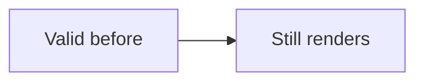
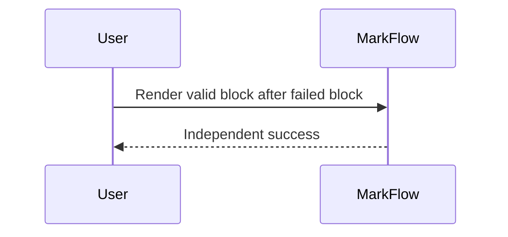

# Mermaid Failure Isolation Example

The repository already contains dedicated successful examples for the supported Mermaid diagram
families. This file covers the missing release scenario: **one broken Mermaid block must fail without
breaking surrounding valid diagrams or Markdown editing**.

## Valid diagram before failure



## Intentionally invalid Mermaid

This block is deliberately malformed and is expected to degrade to exact editable fenced-code source.

```mermaid
this is not a valid Mermaid diagram (
```

## Valid diagram after failure



## Manual checks

- The first and third diagrams render independently.
- The malformed middle block remains recoverable/editable source with diagnosable failure behavior.
- Clicking a valid diagram reveals its exact fenced source and leaving it restores the preview.
- Editing the malformed block does not stale, remove, or duplicate the valid diagram inlays.
- Fixing the malformed source to valid Mermaid causes only that block to converge to a preview.
- Switching Light → Dark → Light does not convert the malformed block into a blank/broken editor.
- Save/reopen preserves all three fenced blocks byte-for-byte unless intentionally edited.
